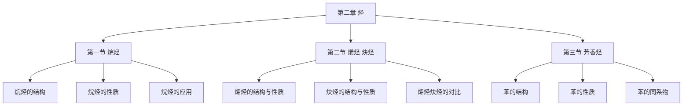

# 整理与提升

## 第二章知识网络

### 知识框架

### 重点知识梳理

#### 1. 烃的分类与通式

| 类别 | 通式 | 官能团 | 不饱和度 |
|------|------|--------|----------|
| 烷烃 | $\ce{C_nH_{2n+2}}$ | 无 | 0 |
| 烯烃 | $\ce{C_nH_{2n}}$ | $\ce{C=C}$ | 1 |
| 炔烃 | $\ce{C_nH_{2n-2}}$ | $\ce{C≡C}$ | 2 |
| 芳香烃 | $\ce{C_nH_{2n-6}}$ | 苯环 | 4 |

#### 2. 重要反应对比

| 反应类型 | 烷烃 | 烯烃 | 炔烃 | 苯 |
|----------|------|------|------|-----|
| 燃烧 | 能 | 能 | 能 | 能 |
| 取代 | 能（需要光照或催化剂） | - | - | 能（需要催化剂） |
| 加成 | - | 能 | 能 | 难 |
| 使 $\ce{KMnO4}$ 褪色 | 不能 | 能 | 能 | 不能 |
| 加聚 | - | 能 | 能 | - |

#### 3. 烯烃的加成规律

**马尔科夫尼科夫规则**：不对称烯烃与 $\ce{HX}$、$\ce{H2O}$ 加成时，$\ce{H}$ 加在含 $\ce{H}$ 多的碳原子上。

#### 4. 苯的特殊性

- 苯中碳碳键的键长完全相等（140 pm）
- 苯不能使高锰酸钾褪色
- 苯易发生取代反应，难发生加成反应
- 苯的同系物可使高锰酸钾褪色

---

## 典型例题

???+ success "例题1"
    
    下列物质中，能使高锰酸钾溶液褪色的是（　）
    
    A. 甲烷　B. 乙烯　C. 苯　D. 乙炔
    
    **答案**：BD
    
    **解析**：烯烃和炔烃含有不饱和键，可被高锰酸钾氧化，使高锰酸钾褪色。甲烷是饱和烃，不能使其褪色。苯虽然含有不饱和结构（凯库勒式中有双键），但实际结构为离域π键，不能被高锰酸钾氧化。

???+ success "例题2"
    
    下列物质中，能与溴发生加成反应的是（　）
    
    A. 甲烷　B. 乙烯　C. 苯　D. 乙炔
    
    **答案**：BD
    
    **解析**：加成反应需要不饱和键。乙烯和乙炔含有 $\ce{C=C}$ 和 $\ce{C≡C}$，能与溴发生加成反应。甲烷是饱和烃，不能发生加成反应。苯虽然不饱和度为4，但由于其稳定性，需要在特定条件下（如紫外光照射）才能与溴发生加成反应。

???+ success "例题3"
    
    下列有机物中，属于苯的同系物的是（　）
    
    A. 苯　B. 甲苯　C. 乙烯　D. 甲烷
    
    **答案**：B
    
    **解析**：苯的同系物是指结构与苯相似、分子组成相差一个或若干个 $\ce{CH2}$ 的苯的衍生物。甲苯 $\ce{C6H5CH3}$ 与苯结构相似，分子组成相差一个 $\ce{CH2}$，是苯的同系物。

???+ success "例题4"
    
    鉴别甲烷、乙烯、乙炔三种气体，可选用的试剂是（　）
    
    A. 酸性高锰酸钾溶液
    
    B. 溴水
    
    C. 银氨溶液
    
    D. 氢氧化钠溶液
    
    **答案**：AB
    
    **解析**：乙烯和乙炔均能使酸性高锰酸钾溶液和溴水褪色。甲烷不能使两者褪色，可区分甲烷与后两者。要进一步区分乙烯和乙炔，可利用乙炔能与银氨溶液反应生成白色沉淀（乙炔银）的特性。

---

## 能力提升

### 易错点分析

!!! warning "常见错误"
    
    1. **混淆苯的结构**：苯的真实结构不是凯库勒式中的交替双键，而是离域π键。
    
    2. **误判苯的性质**：苯不能使高锰酸钾褪色，但不能据此认为苯不含不饱和键。
    
    3. **混淆取代与加成**：烷烃的取代需要光照或催化剂，烯烃、炔烃的加成只需不饱和键。
    
    4. **马尔科夫尼科夫规则应用**：只有不对称烯烃与 $\ce{HX}$、$\ce{H2O}$ 加成才遵循该规则。

### 知识拓展

#### 1. 炔烃的检验

乙炔与银氨溶液反应：

$$\ce{HC≡CH + 2AgNO3 + 2NH3·H2O -> AgC≡CAg↓ + 2NH4NO3 + 2H2O}$$

生成白色乙炔银沉淀，可用于检验炔烃（端炔）。

#### 2. 烯烃的顺反异构

由于碳碳双键不能自由旋转，因此当双键两侧的碳原子上各连接两个不同的原子或原子团时，会产生顺反异构体。

**条件**：
- 碳碳双键不能旋转
- 每个双键碳原子上连接两个不同的原子或原子团

#### 3. 苯的定位效应

苯环上取代基分为两类：

| 类型 | 取代基 | 效应 |
|------|--------|------|
| 邻、对位定位基 | $-\ce{OH}$、$-\ce{NH2}$、$-\ce{OCH3}$、$-\ce{CH3}$ 等 | 使苯环活化，取代基进入邻、对位 |
| 间位定位基 | $-\ce{NO2}$、$-\ce{SO3H}$、$-\ce{COOH}$ 等 | 使苯环钝化，取代基进入间位 |

---

## 自我检测

1. 下列物质中，不属于烃的是（　）
   - A. 甲烷　B. 乙烯　C. 乙醇　D. 苯

2. 下列物质中，能使溴水褪色的是（　）
   - A. 苯　B. 甲烷　C. 乙烯　D. 乙炔

3. 下列物质中，与 $\ce{H2}$ 加成产物为环己烷的是（　）
   - A. 乙烯　B. 乙炔　C. 苯　D. 甲苯

4. 下列物质中，不能使高锰酸钾褪色的是（　）
   - A. 苯　B. 甲苯　C. 乙炔　D. 乙烯

5. 下列说法正确的是（　）
   - A. 苯的凯库勒式能准确反映苯的真实结构
   - B. 苯的同系物可使高锰酸钾褪色
   - C. 烯烃与 $\ce{HBr}$ 加成一定遵循马尔科夫尼科夫规则
   - D. 乙炔与银氨溶液反应可生成黑色沉淀

**参考答案**：1. C　2. CD　3. C　4. A　5. B