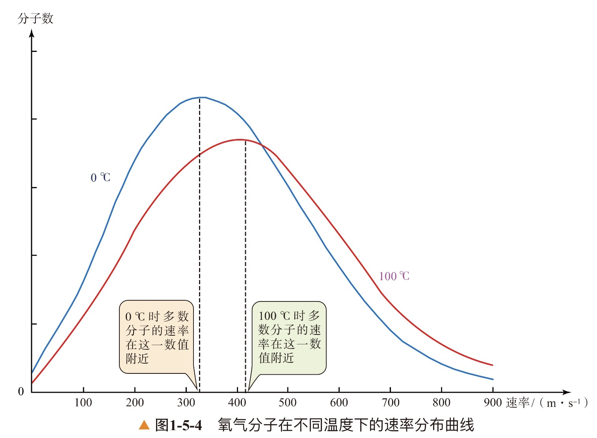

# U1-5 分子热运动的统计规律

## 分子热运动的统计规律

### 统计规律的概念

大量分子做无规则运动时，虽然单个分子的运动是偶然的、随机的，但大量分子的整体运动会表现出一定的规律性。这种大量偶然事件的整体规律叫做**统计规律**。

!!! note "统计规律的特点"
    - 统计规律只对大量微观粒子才有意义
    - 单独几个分子的运动没有统计规律
    - 统计规律揭示的是大量粒子整体行为的规律

### 气体分子运动的特点

#### 分子速率分布

在任意温度下，气体分子的速率分布呈现"中间多、两头少"的规律：

- 大多数分子速率接近某个中间值
- 速率很大和很小的分子都很少

速率分布函数图像呈**倒钟形**曲线，形状类似于正态分布曲线.

!!! note "速率分布规律"
    - 温度升高时，分子速率整体增大，分布曲线向右移动
    - 温度相同时，质量较小的分子平均速率较大
    - $0^\circ\text{C}$ 时，氧气分子平均速率约为 $400 \text{ m/s}$
    - $100^\circ\text{C}$ 时，氧气分子平均速率约为 $500 \text{ m/s}$

#### 不同温度下的速率分布曲线

当温度改变时，速率分布曲线会发生变化：

!!! note "不同温度下图线所围面积的关系"
    **无论温度如何变化，速率分布曲线与横轴所围成的总面积始终等于总分子数。**

如果图像纵轴变为“各速率区间的分子数占总分子数的百分数”，则速率分布曲线与横轴所围成的总面积始终等于1（即100%）。

这一结论的物理意义：

- 曲线下的面积表示分子速率在 0 到 $\infty$ 范围内分布的概率总和
- 所有分子必然具有某个速率，因此概率总和为1
- 不同温度下，曲线形状改变，但面积保持不变（归一化条件）

!!! tip "温度对曲线的影响"
    - 温度升高：曲线峰值右移、最高点降低（最概然速率增大但分子比例减少）
    - 温度降低：曲线峰值左移、最高点升高（最概然速率减小但分子比例增加）
    - 曲线变得更"矮胖"或"高瘦"，但面积始终为1

#### 麦克斯韦速率分布律

气体分子速率分布可以用**麦克斯韦速率分布律**描述：

$$f(v) = 4\pi \left( \frac{m}{2\pi kT} \right)^{3/2} v^2 e^{-\frac{mv^2}{2kT}}$$

!!! tip "三种统计速率"
    - **最概然速率** $v_p$：出现概率最大的速率
    - **平均速率** $\bar{v}$：分子速率的算术平均值
    - **方均根速率** $\sqrt{\bar{v^2}}$：分子速率平方平均值的平方根

### 用统计规律解释宏观现象

#### 为什么温度相同时不同气体分子平均动能相同

温度是分子平均动能的标志。对于理想气体：

$$\bar{E_k} = \frac{3}{2}kT$$

其中 $k$ 为玻尔兹曼常数。平均动能只与温度有关，与分子质量无关。

#### 为什么气体分子能充满整个容器

气体分子间距很大（约为分子直径的10倍），分子间作用力可以忽略不计。分子以各种方向、各种速率运动，最终均匀分布在容器的整个空间。

#### 为什么气体会扩散

气体分子不断运动，不同区域的分子相互进入对方，形成均匀混合。温度越高、分子质量越小，扩散越快。

!!! note "扩散系数与温度的关系"
    扩散系数 $D \propto T^{3/2}$，温度升高时扩散加快。

### 分子动理论与热力学定律

分子动理论为热力学第一定律和第二定律提供了微观解释：

- **热力学第一定律**：$\Delta U = Q + W$ —— 内能是分子动能和分子势能的总和
- **热力学第二定律**：热量不能自发地从低温物体传向高温物体 —— 统计规律的表现

???+ question "自我评价"

    1. 判断：单个分子的运动没有统计规律。（    ）
    
        解答：√

    2. 判断：温度相同时，氧气和氮气分子的平均动能相同。（    ）
    
        解答：√

    3. 为什么说"分子的运动是无规则的，但大量分子的整体运动是有规律的"？
    
        解答：单个分子的运动受到多种偶然因素影响，运动方向和速度随时变化。但大量分子的整体行为会表现出统计规律，如速率分布"中间多、两头少"。这体现了偶然性与必然性的对立统一。

    4. 为什么气体分子的速率分布与温度有关？
    
        解答：温度是分子平均动能的标志。温度越高，分子平均动能越大，分子运动越剧烈，速率分布曲线向右（高速方向）移动，最概然速率增大。

    5. 试解释为什么香水打开瓶盖后，整个房间都能闻到香味。
    
        解答：香水分子不停地做无规则热运动，会从瓶口向周围扩散。在常温下，香水分子平均速率较大（约数百米每秒），而且不断与空气分子碰撞，扩散到房间各处，使人在任意位置都能闻到香味。